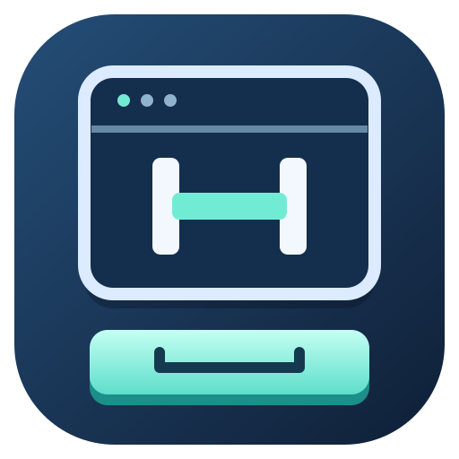

# Hop



Quick file previews for Windows and Linux. Preview images, PDFs, UTF-8 text/source files, folders, and file metadata without opening files in their default applications.

---

## Quick Start

### Windows

1. **Download** the [latest release](https://github.com/prashantkhandelwal/hop/releases) MSI or ZIP
2. **Install** and launch Hop — the tray icon appears in your notification area
3. **Select a file** in Windows Explorer and press **Space** to preview it
4. **Close** with **Space**, **Escape**, or by clicking outside the preview

### Linux

```bash
hop /path/to/file
```

Hop is CLI-based on Linux. Integrate with your file manager by creating a custom action that passes the selected file path to `hop`.

---

## What Can I Preview?

| Type | Supported Formats |
| --- | --- |
| **Images** | PNG, JPEG, BMP, ICO, TIFF/TIF, WebP, PNM, TGA, QOI |
| **Animated GIF** | Full animation with frame timing and looping |
| **PDF** | Full document navigation, zoom, fit-to-page, and scrolling |
| **Video** | MP4, MKV, WebM, MOV, AVI, WMV, MPEG, M4V, TS, OGV, FLV, 3GP (with audio) |
| **Text/Source** | Any UTF-8 text file, up to 256 KiB |
| **Folders** | Directory listing with icon and contents |
| **Other Files** | File type icon, name, and size |

---

## Windows Explorer: Space to Preview

### How It Works

- **Start the watcher:** Run `hop --watch` or double-click the executable
- **Select a file** in an Explorer file-list pane
- **Press Space** to preview it in an always-on-top window
- **Navigate** with arrow keys to move through selected files
- **Close** by pressing **Space**, **Escape**, or clicking outside

### Tray Menu

Right-click the tray icon:

- **Settings:** Adjust video volume (0–100%), controls auto-hide delay (0.5–30 seconds), and optionally enable startup at sign-in
- **About:** View the app icon, version, and tagline: "A quick peek. A smoother workflow."
- **Exit:** Close the watcher and all open preview windows

Settings and About are fixed-size windows without minimize or maximize buttons. Settings actions use large buttons pinned to the bottom.

### Behavior & Limits

- Only one watcher runs per Windows user
- Only one managed preview appears at a time
- The preview **always stays on top** and opens **without taking focus**
- Clicking in the preview (content, title bar, or controls) keeps it open
- Clicking outside the preview closes it
- Multiple selected files preview the first one
- Stale Quick Access shortcuts show their names when files no longer exist (no error)
- Desktop icons, file-open dialogs, and other file managers are not supported

### Configuration

Settings are stored as JSON:
- **Windows:** `%APPDATA%\hop\settings.json`
- **Linux:** `$XDG_CONFIG_HOME/hop/settings.json` or `~/.config/hop/settings.json`

Default settings: 70% volume, 2-second auto-hide delay, startup disabled.

---

## Direct Preview: Windows and Linux

Open a preview from the command line:

```bash
hop /path/to/file
hop --preview /path/to/file
hop -- filename-starting-with-dash
```

Close with **Space**, **Escape**, or the window close button.

Preview windows remember their last normal window position when closed, including
across app restarts and different files. The position is saved separately from playback
settings in `preview-position.json` in the same configuration directory. This applies
to both watcher and standalone previews. Wayland does not support reading or restoring
window positions.

### Differences from Watcher Mode

- Standalone previews **take focus** when opened (unlike watcher mode)
- **Arrow keys do not control file selection** (Explorer isn't running)
- Windows: same outside-click dismissal as watcher mode
- Linux: closes when it loses focus (Wayland may not support always-on-top)

---

## Video Playback

Video plays automatically with audio at your configured volume and loops until closed.

### Requirements

**libmpv client API 2** with the software render API is required for video.

**Windows (x64):**
1. Download `libmpv-2.dll` from [mpv-winbuild-cmake releases](https://github.com/shinchiro/mpv-winbuild-cmake/releases)
2. Place beside the executable: `target\release\libmpv-2.dll`

**Linux:**
```bash
sudo apt install libmpv2       # Debian/Ubuntu
sudo pacman -S mpv             # Arch Linux
```

**Alternative:** Set `HOP_MPV_LIBRARY` environment variable to the full path of `libmpv` (must be from a trusted source).

---

## Preview Limits & Details

### Image Handling

- **Disk limit:** 64 MiB
- **Decode budget:** 256 MiB
- **Dimension limits:** 16,384 pixels per axis
- **Texture size:** Reduced to 4,096 pixels per axis
- **Aspect ratio:** Preserved; centered and scaled to fit

### GIF Handling

- **Frame limit:** 500 frames
- **Memory limit:** 128 MiB of retained frame data
- **Dimension limit:** 2,048 pixels per axis
- **Min delay:** Frame delays below 20 ms are clamped to 20 ms
- **Exceeding limits:** Shows explicit error

### PDF Handling

- **Disk limit:** 64 MiB
- **Page raster limit:** 2,400 pixels per axis
- **Navigation:** Arrow keys, Page Up/Down, Home, End, scroll wheel
- **Zoom:** 25–300% (Ctrl+Scroll to adjust)
- **Fit-to-page mode:** Scroll wheel navigates pages
- **Zoomed mode:** Scroll at edge advances pages; scroll in center scrolls content
- **Limitations:** No forms, text selection, embedded scripts, document links, or password entry

### Text/Source Files

- **Limit:** 256 KiB
- **Format:** UTF-8 only
- **Display:** Read-only, selectable, 16-point padding
- **Recognition:** Supports files without recognized extensions

### Folder Display

- **Layout:** Centered group with folder icon/name on left, scrollable contents on right
- **Limit:** Up to 200 entries
- **Sorting:** Sorted within displayed subset

### Unsupported & Other Formats

- **Office documents, archives, executables, standalone audio:** Show icon, name, and size
- **Binary/non-UTF-8 files:** Show icon, name, and size
- **Missing/unreadable files:** Show explicit error
- **Decoding errors:** Show explicit error

### Loading & Errors

- **Loading spinner:** Animated while content loads
- **Errors:** Displayed when needed; truncation notices written to terminal
- **No headers/details:** Clean pane with just the preview content
- **Background:** Light grey pane background

---

## Building from Source

### Prerequisites

**Windows:**
- Rust 1.93+ (stable)
- MSVC C++ build tools
- (Optional) libmpv-2.dll for video support

**Linux:**
- Rust 1.93+ (stable)
- X11 or Wayland session with OpenGL/EGL
- Build tools: `build-essential pkg-config libx11-dev libxi-dev libxcursor-dev libxrandr-dev libxkbcommon-dev libwayland-dev libegl1-mesa-dev`

### Build

```bash
cargo build --release
```

**Output:**
- Windows: `target\release\hop.exe`
- Linux: `target/release/hop`

**Run:**
```bash
./target/release/hop --watch      # Windows: start watcher
./target/release/hop /path/file   # Any platform: preview a file
```

---

## Automated Builds

### GitHub Actions

The [build workflow](.github/workflows/build.yml) runs on every push.

**Download artifacts:**
- Windows: `hop-windows-x86_64` (portable ZIP)
- Linux: `hop-linux-x86_64` (executable)

**Extract:**
- Windows: Extract to a folder; keep files together
- Linux: `chmod +x hop` after extracting

### GitHub Releases

Tag a version matching `Cargo.toml`:

```bash
git tag v0.1.0
git push origin v0.1.0
```

**Publishes:**
- `hop-0.1.0-windows-x86_64.zip` (portable)
- `hop-0.1.0-linux-x86_64.zip` (with README, LICENSE)
- `hop-0.1.0-x86_64.msi` (Windows installer, if runtime is approved)

---

## Windows Installer (MSI)

### Installation

The MSI uses **cargo-wix 0.3.9** and **WiX Toolset 3.14.1**.

**Features:**
- Installs to `%LOCALAPPDATA%\Programs\Hop` (user-writable, no admin required)
- Creates Start menu shortcuts for Hop and Hop Settings
- Includes approved libmpv runtime (if configured)
- Optional auto-start at sign-in
- Full uninstall support

### Building the Installer

1. Install WiX 3.14.1: https://github.com/wixtoolset/wix3/releases/tag/wix3141rtm
2. Install cargo-wix:
   ```bash
   cargo install cargo-wix --version 0.3.9 --locked
   ```
3. Prepare an approved libmpv runtime (see [Runtime Preparation](#runtime-preparation))
4. Build:
   ```powershell
   .\wix\build-installer.ps1 `
     -RuntimeDirectory 'C:\path\to\approved-runtime' `
     -WixBin 'C:\tools\wix314'
   ```

**Output:** `target\wix\hop-<version>-x86_64.msi`

### Uninstall

- Use Windows Settings to uninstall
- User preview settings are preserved
- Unmanaged files in the installation folder are not deleted

---

## Runtime Preparation

### Automated Runtime Setup (Recommended)

Use the manifest-based workflow in [wix/prepare-runtime.ps1](wix/prepare-runtime.ps1).

**Edit [wix/runtime-manifest.json](wix/runtime-manifest.json):**

- `runtime`: URL, SHA-256, and extraction path for libmpv binary
- `licenses`: License file URLs and SHA-256 hashes
- `sources`: Source archive URLs for GPL/LGPL compliance
- `components`: Dependency inventory with versions, licenses, and referenced materials
- `review`: Reviewer name, date, and approval notes

**Validate:**
```powershell
.\wix\prepare-runtime.ps1 -ValidateOnly
```

**Build:**
```powershell
$runtime = .\wix\prepare-runtime.ps1 -OutputDirectory '.\target\prepared-runtime'
.\wix\build-installer.ps1 -RuntimeDirectory $runtime.RuntimeDirectory -WixBin 'C:\tools\wix314'
```

### External Runtime Bundle

Alternatively, set GitHub Actions variables:

- `HOP_MPV_BUNDLE_URL`: HTTPS URL to `.7z` runtime archive
- `HOP_MPV_BUNDLE_SHA256`: 64-character SHA-256 digest

Compute SHA-256:
```powershell
Get-FileHash .\mpv-runtime.7z -Algorithm SHA256
```

---

## Implementation Details

### Windows Explorer Integration

- **COM Interface:** Shell.BrowserViewEvents
- **Path Reading:** IShellFolderViewDual.SelectedItems
- **Keyboard Monitoring:** Low-level Windows hooks (non-blocking)
- **Navigation:** UI Automation for grid patterns and focus tracking
- **Threading:** Dedicated STA worker for Explorer COM calls, separate MTA worker for layout queries

### Explorer Navigation Behavior

- **Reconnection:** Hops automatically reconnects if the view is rebuilt
- **View Switching:** Matched against focused shell view (tabs supported)
- **Source Tracking:** Handles closing/hiding source tabs without forcing reconnection
- **Grid Navigation:** Arrow keys move through visible items using UI Automation
- **Limitations:** Desktop icons, file-open dialogs, and virtual items not supported

### Cross-Platform Architecture

- **GUI:** egui (immediate-mode UI) with eframe (window handling)
- **Images:** `image` crate (PNG, JPEG, BMP, ICO, TIFF, WebP, PNM, TGA, QOI)
- **GIF:** Native frame decoding and animation
- **PDF:** Embedded Rust renderer (pdfium-render)
- **Video:** libmpv (software rendering)
- **Threading:** Dedicated workers for file loading, layout queries, and view synchronization
- **Error Handling:** Graceful fallback to name-only display for inaccessible items

### Known Limitations

- **Synchronous COM calls:** Deferred to worker threads to avoid deadlocks
- **UI Automation:** Limited to visible grid patterns; performance degrades with large file lists
- **Wayland:** Always-on-top and mouse monitoring behavior is window-manager dependent
- **Network files:** Quick Access shortcuts to deleted network paths fall back to name display

---

## License

MIT

---

## Contributing

Contributions are welcome! Please ensure:
- Existing tests pass: `cargo test --locked`
- Code is formatted: `cargo fmt`
- No new warnings: `cargo clippy --locked`

---

## Support

For issues, feature requests, or questions, please open a GitHub issue.
